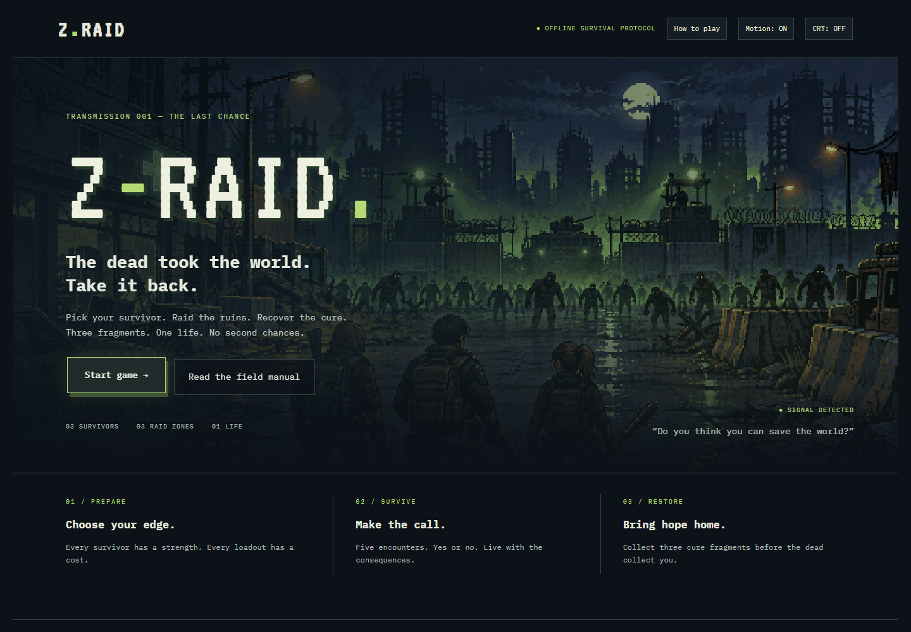

<div align="center">

# 🧟 Z-RAID

### One life. Three raids. A world to save.

The dead took the world. **Take it back.**<br>
A 16-bit-style, text-based survival game where every Yes or No could be your last.

[](https://z-raid.thehawk6353.workers.dev/)

**[Play in your browser ↗](https://z-raid.thehawk6353.workers.dev/)** · No install. No account.



</div>

## 🎒 Gear up. Get out. Get back alive.

1. **Pick your survivor.** Rook brings combat, Echo brings stealth, and Patch brings scavenging. Your choice lasts the whole run.
2. **Choose your raid.** Explore Mercy Pharmacy, Hollow Metro, or Checkpoint 09 with one weapon and one piece of gear.
3. **Make the call.** Survive five connected Yes/No encounters in a randomly selected story. Consider the actions, rewards, and damage—“No” isn't a free escape.
4. **Bring home the cure.** Each completed raid earns a fragment, upgrades your equipment, and raises the danger. Recover all three fragments to win.

**Four weapons. Four gear items. Thirty encounters. One life.**<br>
Collect supplies, recover at camp, and adapt your loadout between raids. Die, and the run is over.

The game fits the screen without scrolling, starting at iPhone SE size (375 × 667). Browse survivors and confirm your choice, then prepare in four steps: **Location → Weapon → Gear → Review**. Every option remains available; its description appears when selected. Both raid decisions stay visible together. The field manual uses six short pages.

Loud actions attract a pursuing horde even when they succeed. Quiet routes can shake it off. Pursuit carries into later encounters, making checks tougher and injuries worse. Watch the pursuit tracker and weigh your supplies against the noise; neither Yes nor No is always the quiet option. Camp recovery is limited to 20 health.

The stat checks, success percentages, and random rolls stay hidden; the probability system still runs behind the scenes.

### 🕹️ Before you head out

- Play with mouse, touch, or **Tab + Enter/Space**.
- Combat, stealth, scavenging, and equipment shape your chances. Good odds still aren't a guarantee.
- The menu has a looping animated backdrop and subtle hover effects. Pixel motes and drifting quarantine fog animate behind every game screen. Toggle **Motion** to pause animation, **CRT** for scanlines, or open **How to play** for the field manual. Reduced-motion settings use a still backdrop and stop ambient animation.
- Runs aren't saved. Refreshing starts you over.

## ⚙️ Under the hood

Built with **HTML, CSS, and vanilla JavaScript**. Static, browser-based, and free of build tools, runtime libraries, a backend, or a database.

| File | What it handles |
| :--- | :--- |
| `content.js` | Survivors, locations, equipment, and encounters |
| `engine.js` | Probability checks, health, upgrades, and run progression |
| `game.js` | Viewport-aware screens, controls, and paginated instructions |
| `art.js` | Stylized survivor/equipment illustrations and pixel environment art |
| `styles.css` | Responsive retro styling, menu motion, and optional CRT effect |

Each raid randomly selects one of two ordered stories for its location; stat-based probability checks decide outcomes. Google Fonts are optional, with monospace fallbacks. Rule checks and balance simulations run with `node verify.cjs`.

Implementation details, rules, hosting instructions, and animation tooling are in [DEVELOPMENT.md](DEVELOPMENT.md).

## 💻 Play locally

Download the repo ZIP, extract it, and open **`index.html`** in a modern browser. No installation needed.

Or serve the folder with Python:

```sh
python -m http.server 8080
```

Open **[http://localhost:8080](http://localhost:8080)**. Use `python3` or `py` instead of `python` if that's how Python is installed on your machine.

---

<div align="center">

**Do you think you can save the world?**

[Enter the ruins ↗](https://z-raid.thehawk6353.workers.dev/) · [Matthew Hawkins](https://github.com/Matthew-Hawk)

</div>


### Stories in the ruins

Each raid zone now has two connected five-moment stories, picked randomly when you enter. Yes and No have distinct success and failure scenes, with context for your survivor, gear and pursuit. Use **What happened** and **Gear & pursuit** to read the result without scrolling. The difficulty rules remain unchanged.
