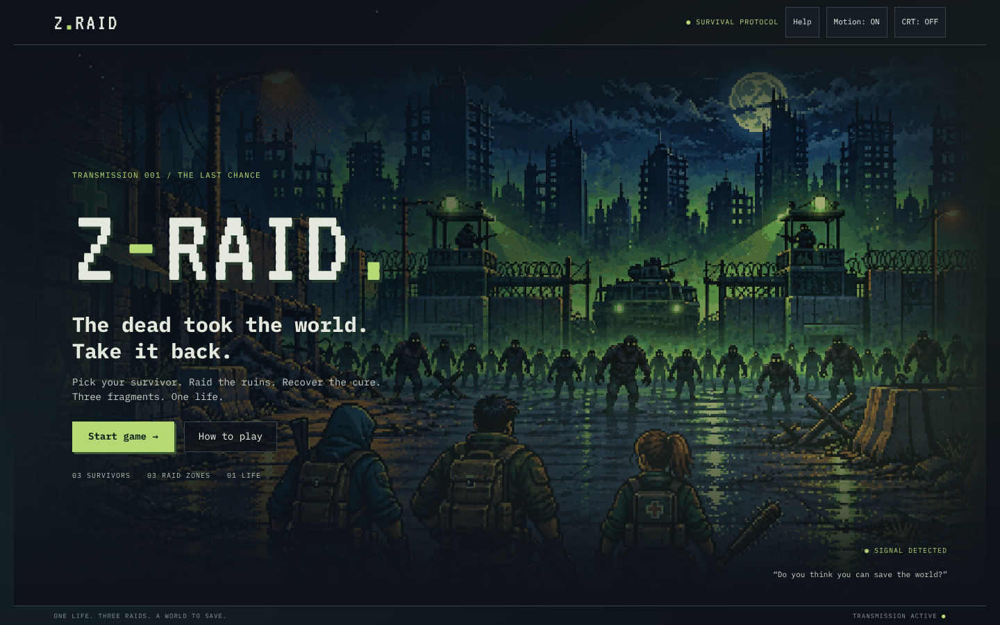
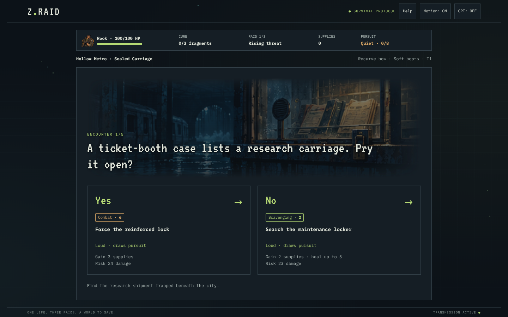
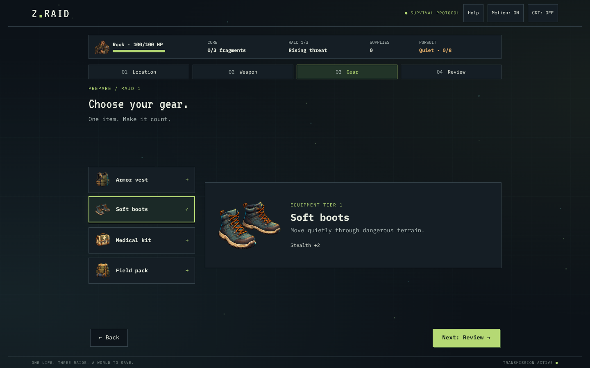

# 🧟 Z-RAID

### One life. Three raids. A world to save.

The dead took the world. **Take it back.** 
A 16-bit-style, story-driven survival game. Pick your survivor, raid the ruins, and bring home the cure.

**[Play in your browser ↗](https://z-raid.pages.dev/)** · No install. No account.

## 🎒 Gear up. Get out. Get back alive.

1. **Choose your survivor.** Rook brings combat, Echo brings stealth, and Patch brings scavenging. One choice for the whole run.
2. **Build your loadout.** Pick a raid zone, one weapon, and one piece of gear. Review your setup before leaving camp.
3. **Make the call.** Survive five connected Yes/No encounters. Read the action, check your strengths, and weigh the rewards against the damage.
4. **Recover the cure.** Each completed raid earns a fragment and improves your equipment—but the next raid gets harder. Bring back all three fragments to win.

**3 survivors · 3 raid zones · 4 weapons · 4 gear items · 6 stories**

Raid **Mercy Pharmacy**, **Hollow Metro**, or **Checkpoint 09**. Each zone has two possible five-moment stories, with distinct outcomes shaped by your survivor, equipment, and pursuit.

### 👣 The dead are listening.

Loud choices attract a pursuing horde—even when they succeed. Quiet routes can break the trail. More pursuit makes later encounters tougher and injuries worse. Neither “Yes” nor “No” is always the safe choice.

Collect supplies, recover limited health at camp, and rethink your equipment between raids. **Die, and the run is over.** Success percentages stay hidden; your decisions still depend on stats and chance.

<strong>🎒 A look at loadout selection</strong>

## 🕹️ Before you head out

- Play with **mouse, touch, or Tab + Enter/Space**.
- Read **What happened** and **Gear & pursuit** after a decision to understand the outcome.
- Toggle **Motion** for animation or **CRT** for a retro display. Reduced-motion preferences are supported.
- Open **How to play** for the field manual. Runs aren't saved; refreshing starts over.

## ⚙️ Under the hood

**HTML, CSS, and vanilla JavaScript**, with illustrated pixel artwork, an animated menu, and ambient effects. Gameplay runs in the browser; there's no backend or database.

`content.js` + `stories.js` define the world and narration; `engine.js` handles hidden probability checks, pursuit, health, and progression; `game.js`, `art.js`, and `styles.css` bring the screens and artwork to life. Cloudflare Workers serves the static game.

For local play, download the repo ZIP, extract it, and open **`index.html`**. Or run `python -m http.server 8080` in the folder and visit **[localhost:8080](http://localhost:8080)** (`python3` or `py` also work, depending on your installation).

With Node.js 22+, run `npm test` for rule and story checks. More development and hosting details: **[DEVELOPMENT.md](DEVELOPMENT.md)**.

---

**Do you think you can save the world?**

[Enter the ruins ↗](https://z-raid.pages.dev/)) · [Matthew Hawkins](https://github.com/Matthew-Hawk)

