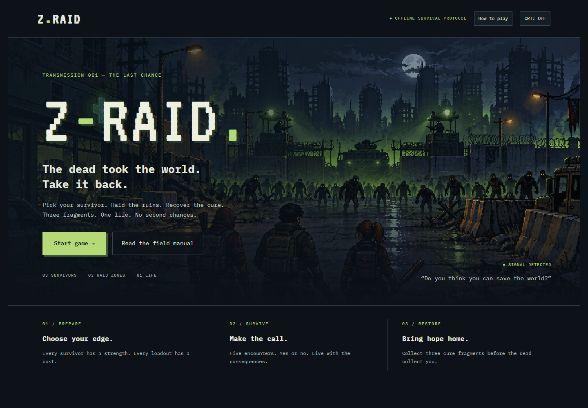
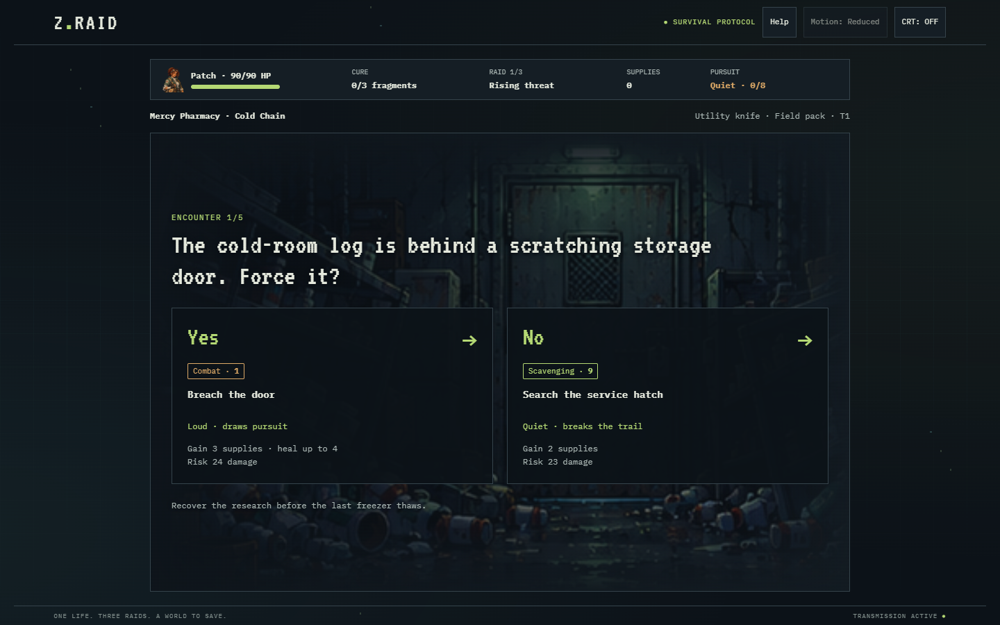

<div align="center">

# 🧟 Z-RAID

### One life. Three raids. A world to save.

The dead took the world. **Take it back.**<br>
An 8-bit, text-based survival game where every Yes or No could be your last.

[](https://z-raid.thehawk6353.workers.dev/)

**[Play in your browser ↗](https://z-raid.thehawk6353.workers.dev/)** · No install. No account.



</div>

## 🎒 Gear up. Get out. Get back alive.

1. **Pick your survivor.** Rook brings combat, Echo brings stealth, and Patch brings scavenging. Your choice lasts the whole run.
2. **Choose your raid.** Explore Mercy Pharmacy, Hollow Metro, or Checkpoint 09 with one weapon and one piece of gear.
3. **Make the call.** Survive five randomized Yes/No encounters. Compare the odds, rewards, and damage—“No” isn't a free escape.
4. **Bring home the cure.** Each completed raid earns a fragment, upgrades your equipment, and raises the danger. Recover all three fragments to win.

**Four weapons. Four gear items. Thirty encounters. One life.**<br>
Collect supplies, recover at camp, and adapt your loadout between raids. Die, and the run is over.



### 🕹️ Before you head out

- Play with mouse, touch, or **Tab + Enter/Space**.
- Combat, stealth, scavenging, and equipment shape your chances. Good odds still aren't a guarantee.
- Toggle **CRT** for scanlines, or open **How to play** for the field manual.
- Runs aren't saved. Refreshing starts you over.

## ⚙️ Under the hood

Built with **HTML, CSS, and vanilla JavaScript**. Static, browser-based, and free of build tools, runtime libraries, a backend, or a database.

| File | What it handles |
| :--- | :--- |
| `content.js` | Survivors, locations, equipment, and encounters |
| `engine.js` | Probability checks, health, upgrades, and run progression |
| `game.js` | Screens, controls, and inline pixel SVG artwork |
| `styles.css` | Responsive retro styling and optional CRT effect |

Encounters are shuffled each raid; stat-based probability checks decide outcomes. Google Fonts are optional, with monospace fallbacks. Rule checks and balance simulations run with `node verify.cjs`.

## 💻 Play locally

Download the repo ZIP, extract it, and open **`index.html`** in a modern browser. No installation needed.

Or serve the folder with Python:

```sh
python -m http.server 8080
```

Open **[http://localhost:8080](http://localhost:8080)**. Use `python3` or `py` instead of `python` if that's how Python is installed on your machine.

---

<div align="center">

**Do you think you can save the world?**

[Enter the ruins ↗](https://z-raid.thehawk6353.workers.dev/) · [Matthew Hawkins](https://github.com/Matthew-Hawk)

</div>
